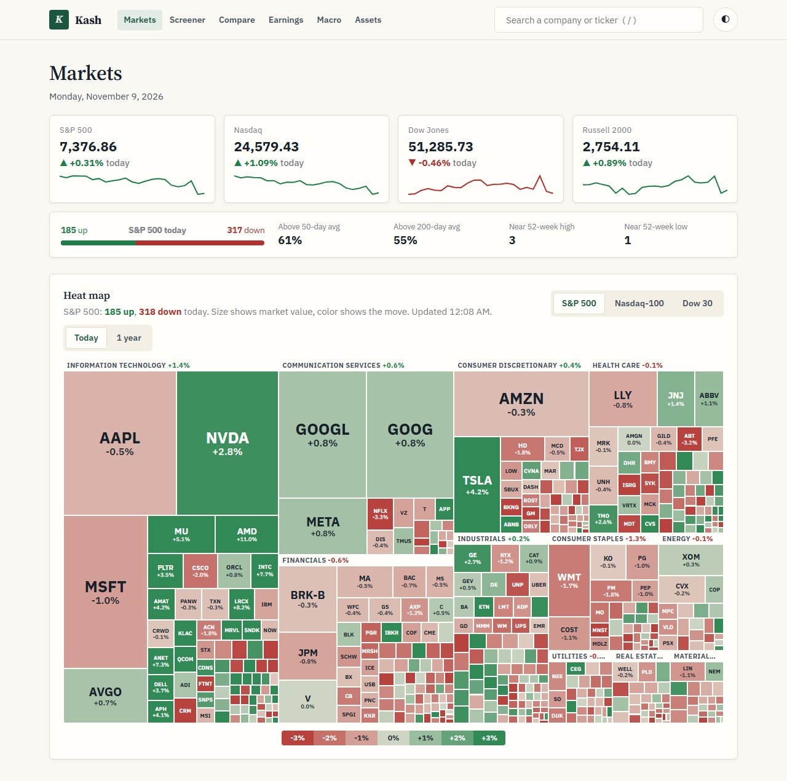
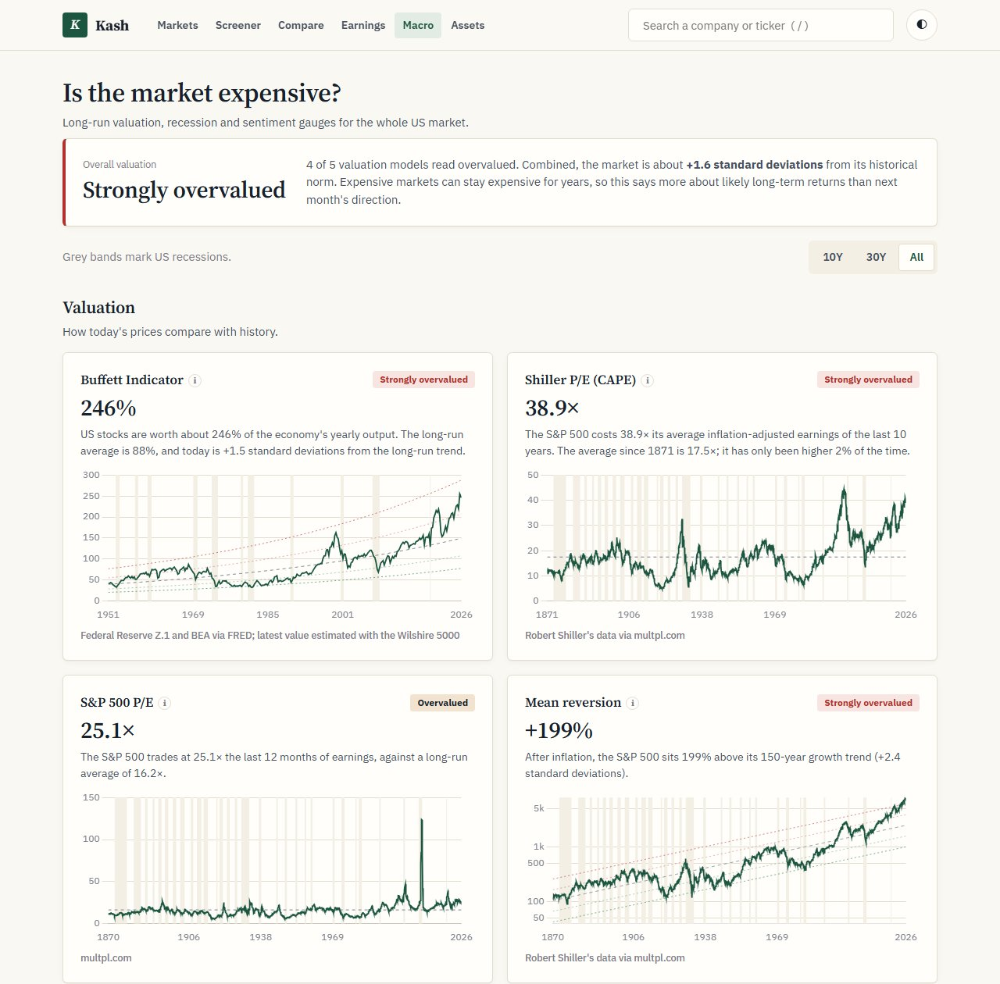

# Kash

A friendly stock analysis tool. It shows full financial statements (income statement, balance sheet,
cash flow and ratios, annual and quarterly, with TTM) with a plain-English explanation on every line,
plus an 8-point scorecard and a "story in charts" overview that answers the questions an investor
actually asks: is it growing, is it profitable, does it make real cash, is it financially healthy,
and is the price right?






| The story in charts | Full financial statements |
|---|---|
|  |  |

## Features

- **Market home page:** index levels, market breadth, your watchlist, a heat map of the S&P 500, Nasdaq-100 or
  Dow 30 (today or 1 year, grouped by sector), top movers, unusual volume and new highs.
- **Macro ("Is the market expensive?"):** Buffett Indicator (market value to GDP), Shiller P/E, S&P 500 P/E, mean
  reversion, earnings yield vs. bonds, an overall verdict, yield curve, Sahm Rule, VIX, junk spreads, consumer
  sentiment and key economic data, with up to 155 years of history and recession shading.
- **Assets:** Bitcoin and other crypto, gold, silver and other metals, oil, farm goods, currencies, sector funds and
  global markets, with returns over every period, comparison charts, and ratios such as gold/silver and Bitcoin in gold.
- **Screener:** about 2,500 US-listed companies with filters, presets, sortable columns and CSV export.
- **Compare:** up to five stocks side by side, with the best value on each line highlighted.
- **Earnings calendar** and a **portfolio tracker** (kept only in your browser).
- **Deeper stock pages:** price action (trend, RSI, moving averages), what $10,000 would be worth vs. the S&P 500,
  Piotroski and Altman scores, industry peers, what's priced in, and what's inside ETFs.
- **8-point scorecard**: growing sales, profitable, generates cash, uses capital well (ROIC),
  solid balance sheet, fairly priced vs. its own P/E history, rewards shareholders, analysts see upside.
  Each check comes with a one-sentence explanation.
- **Up to 15 years of annual statements** from SEC EDGAR 10-K filings, merged with Yahoo Finance for the gaps.
- **Split-consistent history**: SEC share counts and EPS are restated to today's share basis, so P/E and
  per-share history stay correct across stock splits.
- **Forecast:** analysts' buy/hold/sell ratings, price targets, revenue and EPS estimates, the record of
  beating or missing estimates, and recent upgrades and downgrades.
- **Fair value calculator** (EverythingMoney-style): adjust growth, the ending P/E (or P/FCF) and the return
  you want, and see what the stock could be worth today, with conservative and optimistic cases.
- **Ownership:** largest institutional holders and recent insider buying and selling.
- **Dividends:** yearly dividends per share, growth, payout ratio and how many years in a row it was raised.
- **Company:** key dates (next earnings, ex-dividend), trading stats, leadership and pay, latest news,
  and links to recent SEC filings.
- **Hover explanations** on every statement line and ratio, sparklines for each row, and CSV export.
- Price chart from 1 day (with pre-market and after-hours trading) to the full listing history, P/E history, analyst targets, and dark mode.

## Run

On Windows, double-click `start-kash.bat`. It sets up the environment on first run, starts the
server and opens http://localhost:8050 (if Kash is already running, it just opens it). Close its window to stop.

**Start automatically at login (Windows):** put a shortcut to `run-kash-hidden.vbs` in your Startup folder
(press Win+R, type `shell:startup`). It runs the server in the background with no window and logs to
`.cache/server.log`. Double-click `stop-kash.bat` to stop it; delete the shortcut to turn auto-start off.

Or run it manually:

```bash
python -m venv .venv
.venv/Scripts/python -m pip install -r requirements.txt
.venv/Scripts/python -m uvicorn app:app --port 8050
```

Then open http://localhost:8050 (or http://localhost:8050/stock/ACN).

**SEC history needs a contact email.** The SEC asks every automated client to identify itself. Copy
`config.example.json` to `config.json` and put your own email in it, or set the `SEC_USER_AGENT`
environment variable. Without one, the app still works but uses Yahoo's ~4 years of annual data.

## Tests

```bash
.venv/Scripts/python -m pip install -r requirements-dev.txt
.venv/Scripts/python -m pytest                    # everything (~20 s)
.venv/Scripts/python -m pytest -m "not network"   # offline unit tests only
```

The live-data tests (`-m network`) check the numbers against reality: SEC revenue matches Yahoo,
EPS × shares matches net income in every year (which catches stock-split errors), and Apple's
historical P/E is in a sensible range.

## How it works

- `app.py`: FastAPI backend. Fetches Yahoo Finance data (via yfinance), merges in SEC history, and builds
  the statement tables, ratios and scorecard. Responses are cached for 15 minutes.
- `sec.py`: reads SEC EDGAR XBRL "company facts" and maps US-GAAP tags onto the same line items, with
  per-year tag fallbacks (companies rename tags over time), restatement handling (latest filing wins)
  and split normalization. Downloads are cached in `.cache/`.
- `company.py`: company details for the Forecast, Fair value, Ownership, Dividends and Company tabs
  (`/api/company/{ticker}`), plus recent SEC filings from `sec.py`.
- `market.py`: index levels, heat map, screener, movers, earnings calendar and peers: index members from
  Wikipedia and Nasdaq, market data from Yahoo's screener.
- `macro.py`: market valuation, recession and sentiment gauges (FRED, multpl.com/Shiller, Yahoo).
- `assets.py`: crypto, commodities, currencies and funds (Yahoo).
- `scores.py`: Piotroski and Altman scores and total returns.
- `rows.py`: every statement and ratio line, with its label, data source or formula, and plain-English
  description.
- `static/`: the single-page frontend (vanilla JS and Chart.js); `company.js` holds the company tabs, `market.js` the home page and `pages.js` the other pages.

## Data and limitations

- **Annual:** SEC EDGAR (up to 15 fiscal years) for US-GAAP filers, with Yahoo filling any gaps. Foreign
  IFRS filers (e.g. TSM) and funds fall back to Yahoo (~4 years).
- **Quarterly, TTM, prices, analyst targets:** Yahoo Finance via the unofficial
  [yfinance](https://github.com/ranaroussi/yfinance) library. It is meant for personal use and can break
  or be rate-limited when Yahoo changes its site.
- Total Debt from SEC filings counts loans and bonds but not operating leases, so it can be lower than
  Yahoo's figure.
- Quarterly ratios that need a full year of earnings are annualized (×4).
- Yahoo, multpl.com and Nasdaq's list are used for personal research. A public deployment would need licensed data.

## Disclaimer

Kash is a personal learning project. The data may be delayed, incomplete or wrong, and the scorecard
is a set of simple rules of thumb. **Nothing here is investment advice.** Do your own research before
making any investment decision.

## License

[MIT](LICENSE)
