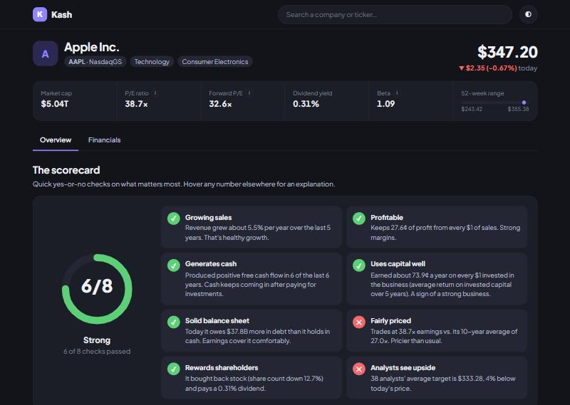
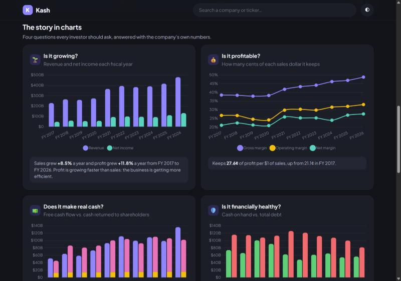
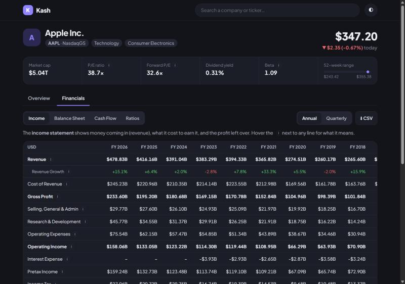

# Kash

A friendly stock analysis tool. It shows full financial statements (income statement, balance sheet,
cash flow and ratios, annual and quarterly, with TTM) with a plain-English explanation on every line,
plus an 8-point scorecard and a "story in charts" overview that answers the questions an investor
actually asks: is it growing, is it profitable, does it make real cash, is it financially healthy,
and is the price right?



| The story in charts | Full financial statements |
|---|---|
|  |  |

## Features

- **8-point scorecard**: growing sales, profitable, generates cash, uses capital well (ROIC),
  solid balance sheet, fairly priced vs. its own P/E history, rewards shareholders, analysts see upside.
  Each check comes with a one-sentence explanation.
- **Up to 15 years of annual statements** from SEC EDGAR 10-K filings, merged with Yahoo Finance for the gaps.
- **Split-consistent history**: SEC share counts and EPS are restated to today's share basis, so P/E and
  per-share history stay correct across stock splits.
- **Hover explanations** on every statement line and ratio, sparklines for each row, and CSV export.
- Price chart from 1 day (with pre-market and after-hours trading) to the full listing history, P/E history, analyst targets, and dark mode.

## Run

On Windows, double-click `start-kash.bat`. It sets up the environment on first run, starts the
server and opens http://localhost:8050. Close its window to stop. Or manually:

```bash
python -m venv .venv
.venv/Scripts/python -m pip install -r requirements.txt
.venv/Scripts/python -m uvicorn app:app --port 8050
```

Then open http://localhost:8050 (or http://localhost:8050/stock/ACN).

**SEC history needs a contact email.** The SEC asks every automated client to identify itself. Copy
`config.example.json` to `config.json` and put your own email in it, or set the `SEC_USER_AGENT`
environment variable. Without one, the app still works but uses Yahoo's ~4 years of annual data.

## Tests

```bash
.venv/Scripts/python -m pip install -r requirements-dev.txt
.venv/Scripts/python -m pytest                    # everything (~20 s)
.venv/Scripts/python -m pytest -m "not network"   # offline unit tests only
```

The live-data tests (`-m network`) check the numbers against reality: SEC revenue matches Yahoo,
EPS × shares matches net income in every year (which catches stock-split errors), and Apple's
historical P/E is in a sensible range.

## How it works

- `app.py`: FastAPI backend. Fetches Yahoo Finance data (via yfinance), merges in SEC history, and builds
  the statement tables, ratios and scorecard. Responses are cached for 15 minutes.
- `sec.py`: reads SEC EDGAR XBRL "company facts" and maps US-GAAP tags onto the same line items, with
  per-year tag fallbacks (companies rename tags over time), restatement handling (latest filing wins)
  and split normalization. Downloads are cached in `.cache/`.
- `rows.py`: every statement and ratio line, with its label, data source or formula, and plain-English
  description.
- `static/`: the single-page frontend (vanilla JS and Chart.js).

## Data and limitations

- **Annual:** SEC EDGAR (up to 15 fiscal years) for US-GAAP filers, with Yahoo filling any gaps. Foreign
  IFRS filers (e.g. TSM) and funds fall back to Yahoo (~4 years).
- **Quarterly, TTM, prices, analyst targets:** Yahoo Finance via the unofficial
  [yfinance](https://github.com/ranaroussi/yfinance) library. It is meant for personal use and can break
  or be rate-limited when Yahoo changes its site.
- Total Debt from SEC filings counts loans and bonds but not operating leases, so it can be lower than
  Yahoo's figure.
- Quarterly ratios that need a full year of earnings are annualized (×4).

## Disclaimer

Kash is a personal learning project. The data may be delayed, incomplete or wrong, and the scorecard
is a set of simple rules of thumb. **Nothing here is investment advice.** Do your own research before
making any investment decision.

## License

[MIT](LICENSE)
